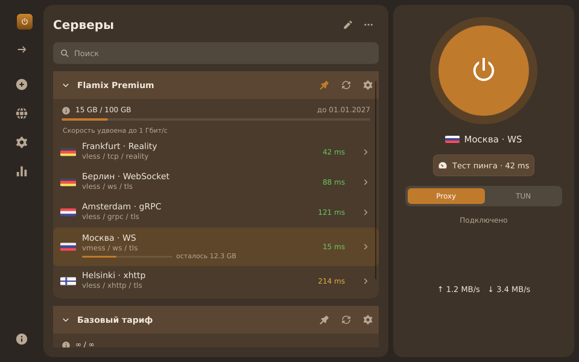
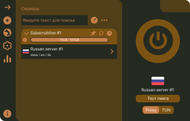

# Flamix

Cross-platform VPN/proxy client written in Rust, with a Slint UI (WinUI 3 / Fluent look).

[](https://github.com/lavrentijav/flamix-client/actions/workflows/ci.yml)
[](https://github.com/lavrentijav/flamix-client/releases)
[](LICENSE)
[](#platforms)

**[🇷🇺 Русский](README.md) | 🇬🇧 English**

> **Status: early development (alpha).** Features and UI change often; builds will appear on the
> [Releases](https://github.com/lavrentijav/flamix-client/releases) page once CI is ready.

Flamix is an open client that runs the external **Xray-core** and **sing-box** cores (like v2rayN) and
brings the features of Happ, v2RayTun and v2rayN into one application.

<!-- A screenshot will be added in upcoming builds:  -->



*Main window mockup.*

## Features

**Protocols**
- VLESS (Reality, XTLS Vision, XHTTP), VMess, Trojan, Shadowsocks (SIP002, plugins)
- Hysteria2 (port hopping), TUIC, WireGuard, SOCKS, HTTP
- Transports: TCP/RAW, WS, gRPC, HTTPUpgrade, XHTTP, H2, mKCP, QUIC

**Modes**
- **Proxy** — system proxy, local SOCKS5 `10808` and HTTP `10809`
- **TUN** — whole-system tunnel (requires administrator/root)

**Subscriptions**
- Formats: base64, plain link list, Xray/sing-box JSON, Clash YAML
- Headers `subscription-userinfo`, `profile-title`, `profile-update-interval`, `support-url`,
  `profile-web-page-url`, `announce`
- Remnawave-compatible HWID headers
- **Backup subscription URLs** (`profile-backup-urls`) and **per-server traffic**
  (`server-userinfo` / `userinfo=` parameter) — see the [specification](docs/subscription-headers.md)

**Links and import**
- Own scheme `flamix://import/<url>`
- Understands other clients' links: `happ://add/…`, `v2raytun://import/…`, `v2rayng://install-sub?url=…`,
  `clash://install-config?url=…`, `sing-box://import-remote-profile?url=…`
- Import from clipboard

**Routing and diagnostics**
- Presets: Global, "Bypass RU" (RU sites and IPs direct, ads blocked), Custom (domains, IPs, processes in TUN)
- Ping: TCP and a real URL test through the core
- Per-subscription traffic bar, per-server traffic bar, statistics page
- Tray, autostart, light/dark theme, RU/EN UI

## Comparison

| Feature | Flamix | Happ | v2RayTun | v2rayN |
|---|:---:|:---:|:---:|:---:|
| Open source | ✅ | ❌ | ❌ | ✅ (GPL-3.0) |
| Desktop: Windows / macOS / Linux | ✅ | ? | ? | ✅ |
| TUN mode | ✅ | ✅ | ? | ✅ |
| Backup subscription URLs | ✅ | ? | ? | ? |
| Per-server traffic | ✅ | ? | ? | ? |
| Xray-core | ✅ | ✅ | ✅ | ✅ |
| sing-box | ✅ | ? | ? | ✅ |
| Understands other clients' deep links | ✅ | ? | ? | ? |

"?" — no data, so we do not guess.

## Platforms

- **Windows** 10/11 x64
- **macOS** 11+ (universal)
- **Linux** x86_64 / aarch64: Debian/Ubuntu (`.deb`), Fedora/RHEL (`.rpm`), Arch (PKGBUILD),
  any distro (AppImage, `.tar.gz`)
- **Mobile** (Android, iOS) — planned

## Download and install

Ready-made builds are published on the [Releases](https://github.com/lavrentijav/flamix-client/releases) page.

Step-by-step instructions per platform (deb, rpm, PKGBUILD, AppImage, `tar.gz`, macOS Gatekeeper, etc.) —
see **[docs/install.md](docs/install.md)**.

## Quick start

1. **Add a subscription**: "Add" → paste the subscription URL (or a `flamix://…` / `vless://…` link from the clipboard).
2. **Pick a server** in the list (the "Ping test" button shows latency).
3. **Connect**: **Proxy** mode (system proxy + local SOCKS5/HTTP) or **TUN** (whole traffic,
   requires administrator/root).
4. Refresh the subscription with the "Refresh" button — if the primary URL is down, the client switches to a backup.

Routing presets (Global, "Bypass RU", Custom) are configured on the **Routing** page.

## For providers

Flamix reads the standard subscription headers (`subscription-userinfo`, `profile-title`,
`profile-update-interval`, `support-url`, `profile-web-page-url`, `announce`), Remnawave-compatible
HWID headers, and two optional extensions:

- **Backup subscription URLs** — `profile-backup-urls: https://a.example/sub, https://b.example/sub`
- **Per-server traffic** — the `server-userinfo` header or the `userinfo=` parameter in a link:

```
vless://uuid@de1.example.com:443?type=ws&security=tls&userinfo=download%3D5368709120%3Btotal%3D53687091200#🇩🇪 Germany
```

Full specification of formats, headers and body metadata — see
**[docs/subscription-headers.md](docs/subscription-headers.md)**.

## Build from source

Build instructions (including building on the server via `scripts/ru1` and CI) — see
**[docs/build.md](docs/build.md)**.

## Project structure

```
crates/flamix-core   # platform-independent logic: model, links, subscriptions, configs, store, ping
crates/flamix-sys    # OS integration: system proxy, core processes, elevation, autostart
app/flamix           # Slint desktop app (ui/*.slint, src/*.rs)
docs/                # specs, tasks, design
scripts/             # build/packaging scripts (scripts/ru1 — build on the server)
```

## Roadmap

- [ ] 🚧 Core logic: model, links, subscriptions, configs, store, ping — in progress
- [ ] 🚧 OS integration: system proxy, core processes, elevation, autostart — in progress
- [ ] 🚧 Slint main window, themes, RU/EN — in progress
- [ ] 🚧 Packaging and CI: deb, rpm, PKGBUILD, AppImage, tar.gz, Windows installer, macOS `.dmg` — in progress
- [ ] Android — planned
- [ ] iOS — planned

## Credits

- [Xray-core](https://github.com/XTLS/Xray-core) — proxy core
- [sing-box](https://github.com/SagerNet/sing-box) — proxy core
- [Slint](https://slint.dev) — UI framework
- [Alfa-Bank icons](https://github.com/core-ds/icons) (`@alfalab/icons-glyph`, MIT) — icon set;
  license text in [app/flamix/assets/icons/LICENSE-alfalab.txt](app/flamix/assets/icons/LICENSE-alfalab.txt)

## Contributing

See [CONTRIBUTING.md](CONTRIBUTING.md). Questions and bugs — in
[Issues](https://github.com/lavrentijav/flamix-client/issues).

## License

**GPL-3.0-or-later**. Full text in the [LICENSE](LICENSE) file.
