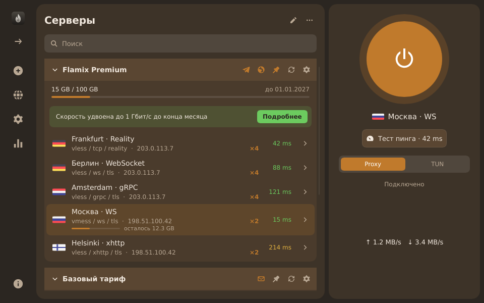
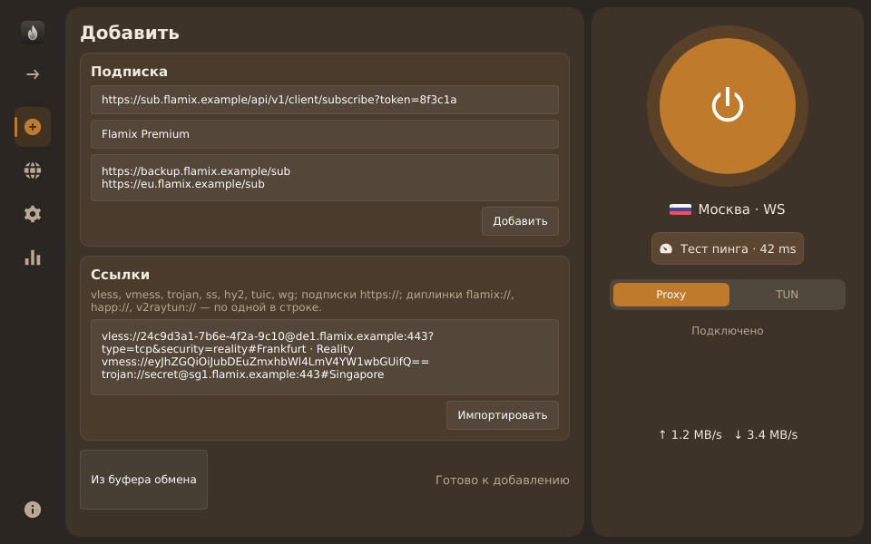
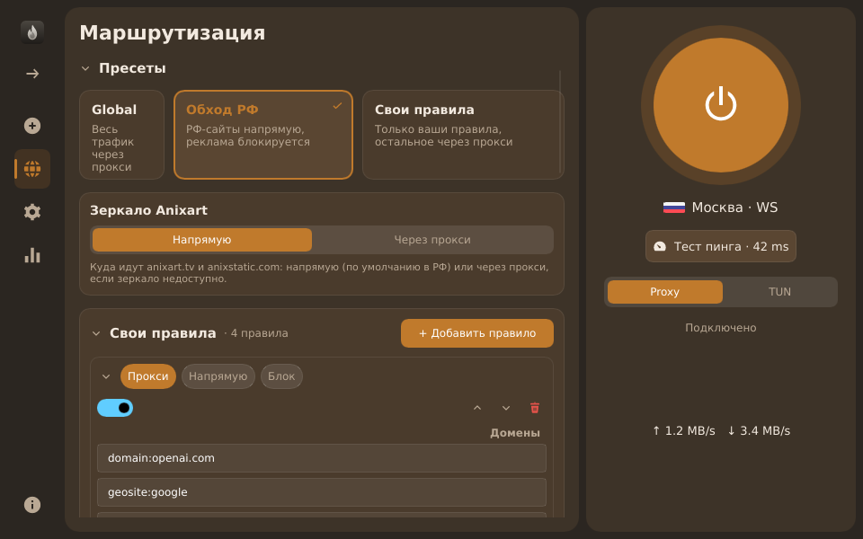
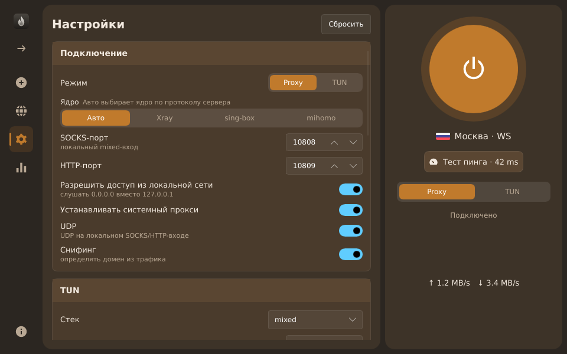
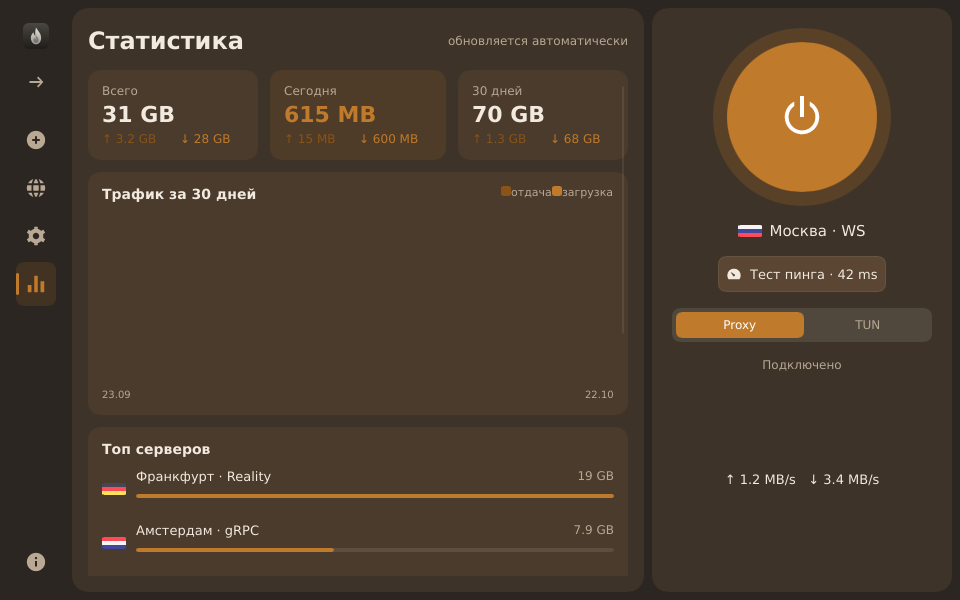
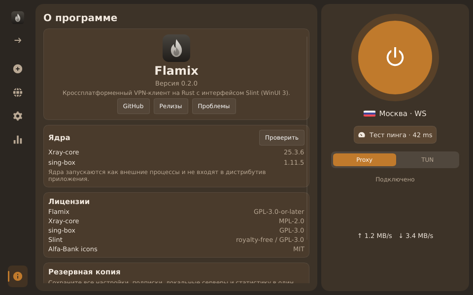

# Flamix

Кроссплатформенный VPN/proxy-клиент на Rust с интерфейсом на Slint (вид WinUI 3 / Fluent).

[](https://github.com/lavrentijav/flamix-client/actions/workflows/ci.yml)
[](https://github.com/lavrentijav/flamix-client/releases)
[](LICENSE)
[](#платформы)

**🇷🇺 Русский | [🇬🇧 English](README.en.md)**

> **Статус: ранняя разработка (alpha).** Функции и интерфейс меняются, сборки появятся на странице
> [Releases](https://github.com/lavrentijav/flamix-client/releases), когда будет готов CI.

Flamix — открытый клиент, который запускает внешние ядра **Xray-core** и **sing-box** (как v2rayN) и объединяет
возможности Happ, v2RayTun и v2rayN в одном приложении.

## Скриншоты

Тёмная тема, все вкладки (снято на демо-данных).

| Серверы | Добавить |
|---|---|
|  |  |
| **Маршрутизация** | **Настройки** |
|  |  |
| **Статистика** | **О программе** |
|  |  |

## Возможности

Окно состоит из левой панели вкладок, списка серверов посередине и панели подключения справа.

- **Серверы** — подписки со сворачиванием и закреплением, полоса трафика подписки и отдельных серверов,
  пинг (TCP и через ядро), поиск, сортировка по пингу, проверка выходного IP, обновление всех подписок.
- **Добавить** — подписка по URL (с именем и резервными адресами), список ссылок `vless://`, `vmess://`,
  `trojan://`, `ss://`, `hy2://` и других (по одной в строке), импорт из буфера обмена.
- **Маршрутизация** — пресеты «Global», «Обход РФ» и «Свои правила»; переключатель зеркала Anixart (напрямую или
  через прокси); свои правила по доменам, IP и процессам с действиями «прокси», «напрямую», «блок»; маршрутизация,
  которую прислал провайдер.
- **Настройки** — режим Proxy или TUN, выбор ядра (Авто, Xray, sing-box, mihomo), порты, доступ из локальной сети,
  системный прокси, UDP, сниффинг, параметры TUN, DNS, адрес для проверки пинга, геоданные, автозапуск, тема.
- **Статистика** — трафик за 30 дней и самые загружаемые серверы.
- **О программе** — версия, версии ядер, лицензии, резервная копия настроек и подписок.

**Протоколы:** VLESS (Reality, XTLS Vision, XHTTP), VMess, Trojan, Shadowsocks (SIP002, плагины),
Hysteria2 (port hopping), TUIC, WireGuard, SOCKS, HTTP.
**Транспорты:** TCP/RAW, WS, gRPC, HTTPUpgrade, XHTTP, H2, mKCP, QUIC.

Ядра: **Xray-core** для большинства протоколов, **sing-box** для Hysteria2 и TUIC, **mihomo** как вариант
по выбору. Режим «Авто» сам выбирает ядро под протокол сервера.

## Сравнение

| Возможность | Flamix | Happ | v2RayTun | v2rayN |
|---|:---:|:---:|:---:|:---:|
| Открытый исходный код | ✅ | ❌ | ❌ | ✅ |
| Десктоп: Windows / macOS / Linux | ✅ | ✅ | ? | ✅ |
| TUN-режим | ✅ | ✅ | ? | ✅ |
| Резервные URL подписки | ✅ | ✅ | ❌ | ❌ |
| Трафик по каждому серверу | ✅ | ❌ | ❌ | ❌ |
| Резервные серверы и мультитрафик | 🚧 | ❌ | ❌ | ✅ |
| Xray-core | ✅ | ✅ | ? | ✅ |
| sing-box | ✅ | ✅ | ? | ✅ |
| Понимает deep links других клиентов | ✅ | ❌ | ? | ? |

«?» — данных нет, чтобы не угадывать. По данным публичной документации на октябрь 2026.

## Платформы

- **Windows** 10/11 x64
- **macOS** 11+ (universal)
- **Linux** x86_64 / aarch64: Debian/Ubuntu (`.deb`), Fedora/RHEL (`.rpm`), Arch (PKGBUILD),
  любой дистрибутив (AppImage, `.tar.gz`)
- **Мобильные** (Android, iOS) — в планах

## Скачать и установить

Готовые сборки публикуются на странице [Releases](https://github.com/lavrentijav/flamix-client/releases).

Пошаговая инструкция по платформам (deb, rpm, PKGBUILD, AppImage, `tar.gz`, macOS Gatekeeper и т. д.) —
в документе **[docs/install.md](docs/install.md)**.

## Быстрый старт

1. **Добавьте подписку.** Вкладка «Добавить» → вставьте URL подписки. Можно скопировать ссылку
   (`flamix://…`, `happ://…`, `v2raytun://…`, `vless://…` и т. д.) и нажать «Из буфера обмена».
2. **Выберите сервер** в списке. Кнопка «Тест пинга» покажет задержку.
3. **Подключитесь** кнопкой питания справа. Режим **Proxy** ставит системный прокси и поднимает локальные
   SOCKS5 `10808` и HTTP `10809`. Режим **TUN** направляет весь трафик системы и требует прав администратора
   или root.
4. **Выберите маршрутизацию** на вкладке «Маршрутизация». Для российских сайтов обычно подходит «Обход РФ».
5. **Обновляйте подписку** кнопкой на карточке подписки. Если основной адрес недоступен, клиент пробует резервные.

Если сервер не подключается, попробуйте другое ядро на вкладке «Настройки» → «Ядро». TUN на Windows без прав
администратора не работает: клиент предложит перезапуск с ними.

## Для провайдеров

Flamix читает заголовки подписки так же, как Happ и v2RayTun, и добавляет несколько своих возможностей.
Полный список и форматы — в **[docs/subscription-headers.md](docs/subscription-headers.md)**. Коротко:

| Заголовок | Что делает в клиенте |
|---|---|
| `profile-title` | название подписки (можно `base64:`) |
| `subscription-userinfo` | трафик и срок действия подписки |
| `profile-update-interval` | интервал автообновления, в часах |
| `support-url` | кнопка поддержки; для `t.me` и `tg://` — значок Telegram, для `mailto:` — конверт |
| `profile-web-page-url` | кнопка сайта; появляется только если заголовок задан |
| `announce` | текст объявления над серверами |
| `sub-info-text`, `sub-info-color`, `sub-info-button-text`, `sub-info-button-link` | баннер: текст, цвет (`red`, `blue`, `green`), кнопка |
| `sub-expire`, `sub-expire-button-link` | уведомление об истечении срока (заменяет баннер) |
| `profile-backup-urls` (алиасы `fallback-url`, `fallback-urls`, `backup-urls`) | резервные адреса подписки |
| `server-userinfo` и параметр `userinfo=` в ссылке | трафик и срок для каждого сервера отдельно |
| `providerid` | идентификатор провайдера (в заголовке, в теле `#providerid X` или во фрагменте URL) |
| `update-always` | обновлять подписку при каждом запуске |
| `network-filter` | оставить только серверы с нужным транспортом или протоколом |
| `subscription-refill-date` | дата сброса трафика |
| `routing`, `routing-enable` | маршрутизация провайдера (ссылка `happ://routing/…` или base64-JSON) |
| `new-url`, `new-domain` | замена адреса подписки |
| `x-hwid-limit`, `x-hwid-active`, `x-hwid-max-devices-reached`, `x-hwid-not-supported` | лимит устройств из ответа панели |
| `socks-auth-*`, `http-auth-*` | авторизация локальных портов клиента |

Клиент отправляет при запросе подписки заголовок `x-hwid` и `User-Agent: Flamix/…`.
Ключи, которые клиент пока не использует, сохраняются и не мешают разбору подписки.

Пример трафика по серверам в ссылке:

```
vless://uuid@de1.example.com:443?type=ws&security=tls&userinfo=download%3D5368709120%3Btotal%3D53687091200#🇩🇪 Germany
```

## Сборка из исходников

Нужен [Rust](https://rustup.rs) (stable, rustup) и системные зависимости для вашей ОС. Кратко:

```
cargo build --release -p flamix
cargo test --workspace
```

Подробная инструкция (зависимости по платформам, упаковка) — в документе
**[docs/build.md](docs/build.md)**.

## Структура проекта

```
crates/flamix-core   # платформо-независимая логика: модель, ссылки, подписки, конфиги, хранилище, пинг
crates/flamix-sys    # интеграция с ОС: системный прокси, процессы ядер, elevation, автозапуск
app/flamix           # десктопное приложение на Slint (ui/*.slint, src/*.rs)
docs/                # спецификации и дизайн
scripts/             # скрипты сборки и упаковки
```

## План развития

- [ ] 🚧 Логика ядра: модель, ссылки, подписки, конфиги, хранилище, пинг — в работе
- [ ] 🚧 Интеграция с ОС: системный прокси, процессы ядер, elevation, автозапуск — в работе
- [ ] 🚧 Главное окно на Slint, темы, RU/EN — в работе
- [ ] 🚧 Упаковка и CI: deb, rpm, PKGBUILD, AppImage, tar.gz, Windows-инсталлятор, macOS `.dmg` — в работе
- [ ] Резервные серверы и мультитрафик — в планах ([docs/failover.md](docs/failover.md))
- [ ] Android — в планах
- [ ] iOS — в планах

## Благодарности

- [Xray-core](https://github.com/XTLS/Xray-core) — прокси-ядро
- [sing-box](https://github.com/SagerNet/sing-box) — прокси-ядро
- [Slint](https://slint.dev) — UI-фреймворк
- [Alfa-Bank icons](https://github.com/core-ds/icons) (`@alfalab/icons-glyph`, MIT) — набор иконок;
  текст лицензии в [app/flamix/assets/icons/LICENSE-alfalab.txt](app/flamix/assets/icons/LICENSE-alfalab.txt)

## Участие

См. [CONTRIBUTING.md](CONTRIBUTING.md). Вопросы и баги — в
[Issues](https://github.com/lavrentijav/flamix-client/issues).

## Лицензия

**GPL-3.0-or-later**. Полный текст — в файле [LICENSE](LICENSE).
